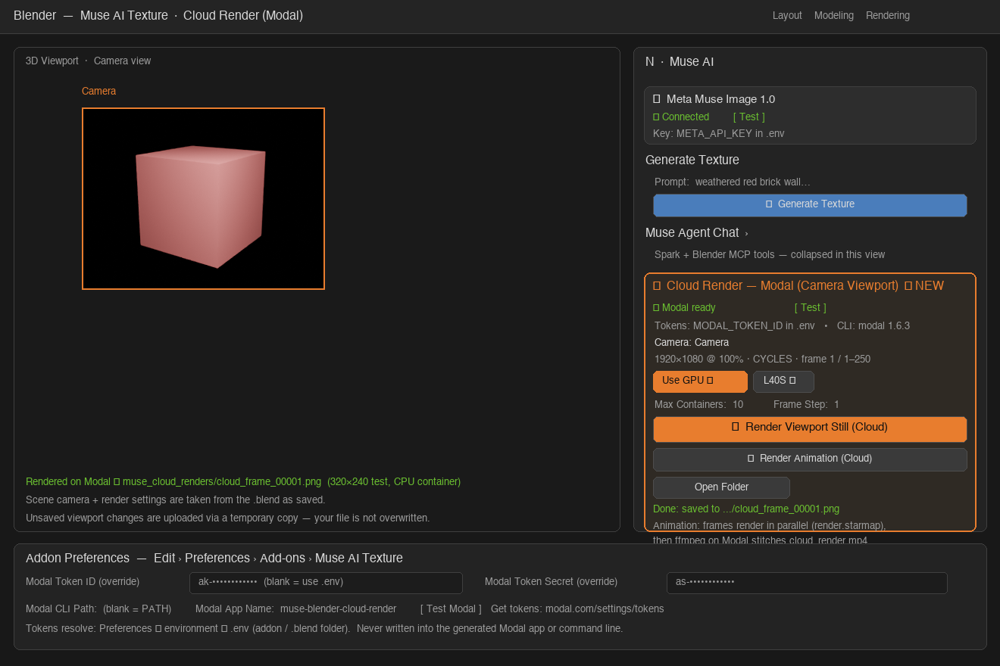
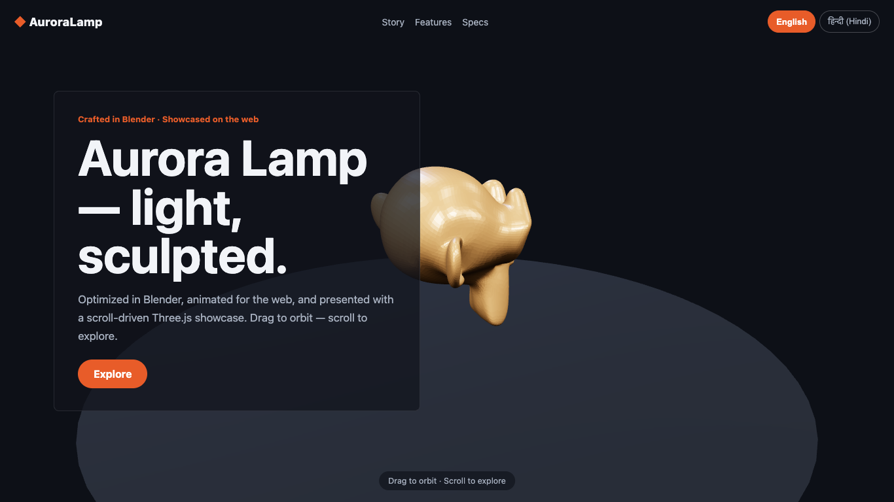

# Muse Harness — Blender add-on

Generate AI textures, drive materials and Geometry Nodes, chat with a
Blender agent, segment Gaussian splats, render in the cloud, and build
product-showcase websites — without leaving Blender.

**Muse Harness** connects Blender to two cloud services:

| Service | What it powers in the add-on | You need |
|---|---|---|
| **Meta Model API** (`api.meta.ai`) | Texture generation, agent chat, splat segmentation | One Meta API key |
| **Modal** (`modal.com`) | Cloud rendering of your scene camera | Modal account + tokens + CLI |

You only need to set up the services you use. Textures, chat, and splats
work with the Meta key alone; Modal is only for cloud rendering.



## Contents

- [Quick start](#quick-start)
- [Install the add-on](#install-the-add-on)
- [Connect the APIs](#connect-the-apis-meta-model-api--modal)
- [Your first texture](#your-first-texture)
- [Feature guides](#feature-guides)
- [Meta Model API reference](#meta-model-api-reference)
- [Modal API reference](#modal-api-reference)
- [File map](#file-map)
- [Development and tests](#development-and-tests)
- [Troubleshooting](#troubleshooting)

## Quick start

Five minutes, no terminal required:

1. **Install** — download [`muse_ai_texture.zip`](muse_ai_texture.zip),
   then in Blender go to **Edit → Preferences → Add-ons → Install from
   Disk…**, pick the zip, and tick the **Muse Harness** checkbox.
   ([Detailed steps](#option-a--install-from-zip-recommended))
2. **Add your Meta key** — get a key at [dev.meta.ai](https://dev.meta.ai)
   → **API Keys**, then paste it in **Edit → Preferences → Add-ons →
   Muse Harness → Meta API Key**. Click **Test** — it should say
   *Connected*.
3. **Generate** — press `N` in the 3D Viewport, open the **Muse Harness**
   tab, select a mesh, type a prompt (e.g. `weathered red brick wall`),
   and click **Generate Texture**.

That is the whole setup for textures, the agent chat, and splat
segmentation. Add Modal later only if you want cloud renders
([Modal setup](#2-modal--only-for-cloud-rendering)).

## Prerequisites

| Requirement | Notes |
|---|---|
| Blender **4.2+** | Tested on 5.4. Splat import needs 5.3+; splat separation uses the 5.4 point-delete path |
| Meta API key | From [dev.meta.ai](https://dev.meta.ai), looks like `LLM\|…\|…`. Powers Muse Image, Muse Spark, and SAM 3.1 |
| Modal account *(optional)* | Only for cloud rendering. Needs the Modal CLI: `pip install modal` |
| Internet access | All AI models run in the cloud; nothing is downloaded to your GPU |

No local GPU, CUDA, or model weights are required.

## Install the add-on

### Option A — Install from zip (recommended)

This is the simple way. You do not need Git or a terminal.

1. Download the add-on zip:
   - From this repository, use the committed
     [`muse_ai_texture.zip`](muse_ai_texture.zip), or
   - grab `muse_ai_texture.zip` from the project's Releases page.
   
   > Do **not** unzip it. Blender installs from the `.zip` directly.
2. Open Blender.
3. Go to **Edit → Preferences → Add-ons**.
4. Click the drop-down arrow (⌄) at the top-right and choose
   **Install from Disk…** (called **Install…** in older Blender versions).
5. Select `muse_ai_texture.zip` and confirm.
6. Find **Muse Harness** in the add-on list and tick its checkbox to
   enable it.
7. Add your API key in the add-on's Preferences panel that appears
   below the checkbox ([Meta key setup](#1-meta-model-api--required-for-most-features)),
   or add it later — you can open the same panel any time via
   **Edit → Preferences → Add-ons → Muse Harness**.
8. Open the **3D Viewport**, press `N` to show the sidebar, and open the
   **Muse Harness** tab. You should see the *Muse Agent Chat* panel and
   the *Muse Harness* panel with a **Status** box.

> If the tab does not appear, the add-on is not enabled — repeat step 6
> and check Blender's **Window → Toggle System Console** (or terminal)
> for an error on startup.

### Option B — Install from source (developers)

Clone the repo and either zip the add-on yourself or copy it into
Blender's add-ons folder:

```bash
git clone https://github.com/biomathcode/meta_blender_ai_plugin.git
cd meta_blender_ai_plugin

# Build the installable zip (same layout as the shipped one)
rm -f muse_ai_texture.zip
zip -r muse_ai_texture.zip muse_ai_texture -x "*/__pycache__/*" "*/.env"
```

Then follow Option A, step 2 onwards, with your freshly built zip.

Alternatively, copy or symlink the `muse_ai_texture/` folder into your
Blender add-ons directory (e.g. `~/.config/blender/4.2/scripts/addons/`
on Linux), restart Blender, and enable **Muse Harness** as above.
Symlinking is handy for development: edits take effect on restart
(or after disabling/re-enabling the add-on).

### Update or uninstall

- **Update:** install the newer zip over the old one (Option A). Your
  Preferences (keys, folders) are kept. In Blender, disable and
  re-enable the add-on after updating.
- **Uninstall:** **Edit → Preferences → Add-ons → Muse Harness →**
  drop-down **→ Remove**. Delete your `.env` file separately if you
  created one — Blender never writes keys to it.

## Connect the APIs (Meta Model API + Modal)

Muse Harness uses **two independent services**. They have separate
keys, separate setup, and separate status lines in the panel — a
problem with one never blocks the other (except that cloud rendering
additionally needs a scene camera, not the Meta key).

|  | Meta Model API | Modal |
|---|---|---|
| Powers | Muse Image textures, Muse Spark agent, SAM 3.1 splats | Cloud camera renders (still + animation) |
| Sign up | [dev.meta.ai](https://dev.meta.ai) | [modal.com](https://modal.com) |
| Credential | API key (`LLM\|…\|…`) | Token ID + Secret (`ak-…` / `as-…`) |
| Env vars | `META_API_KEY` | `MODAL_TOKEN_ID`, `MODAL_TOKEN_SECRET` |
| Extra install | None | Modal CLI (`pip install modal`) |
| Verify in Blender | **Test** button (Preferences or Status box) | **Test Modal** button (Preferences or Cloud Render panel) |

### The simple way to add keys

You have two choices for each service. **Pasting in Preferences is the
simplest** — no files to edit:

- **Edit → Preferences → Add-ons → Muse Harness**, paste the value(s),
  done. Preferences always win over every other source.

Or use a **`.env` file** (better if you reinstall often, work across
machines, or script Blender). Copy
[`.env.example`](muse_ai_texture/.env.example) to a file named `.env`,
fill it in, and place it **next to your `.blend` file** (recommended),
in the add-on folder, or point Preferences → *.env File* at it:

```ini
# .env — keep this file private, never commit it
META_API_KEY=LLM|your-meta-key-here
MODAL_TOKEN_ID=ak-your-modal-token-id
MODAL_TOKEN_SECRET=as-your-modal-token-secret
```

<details>
<summary>How keys are resolved (lookup order)</summary>

For both services the add-on checks, in order:

1. Addon Preferences (the paste-in fields)
2. Environment variables
3. A `.env` file — the path in Preferences → *.env File*, then next to
   the open `.blend`, then the add-on folder, then the working
   directory, then your home directory

For the Meta key, `MODEL_API_KEY` and `MUSE_API_KEY` are accepted as
aliases of `META_API_KEY`. A half-filled pair (e.g. only a Modal Token
ID in Preferences) is completed from the next source. The panel's
Status box always shows **where the active key was found**, so you can
confirm which source won.

</details>

### 1. Meta Model API — required for most features

1. Go to [dev.meta.ai](https://dev.meta.ai) and sign in.
2. Open **API Keys** and create a key. Keys look like `LLM|…|…`.
   This is a *Model API* key — other Meta developer keys will not work
   (they return HTTP 401/403).
3. Add it by pasting into Preferences (simple way, above) or as
   `META_API_KEY=…` in a `.env` file.
4. Click **Test** in Preferences (or **Test Connection** in the panel).
   Success reads: *Connected. muse-image-1.0 is available (… models).*
   This performs a `GET /v1/models` call against the API
   ([reference](#meta-model-api-reference)).

One key covers all three Meta models used by the add-on:
`muse-image-1.0` (textures), `muse-spark-1.1/1.2/1.3` (agent chat),
and `sam-3.1` (splat segmentation). There is no separate SAM token,
no Hugging Face account, and no weights download.

### 2. Modal — only for cloud rendering

Modal renders your scene camera in a cloud container (Blender running
as the `bpy` Python package), so you can render heavy frames without
tying up your machine.

1. Install the Modal CLI (one-time, in a terminal):

   ```bash
   pip install modal
   modal --version   # sanity check
   ```

2. Create tokens in **either** way:
   - Browser: [modal.com/settings/tokens](https://modal.com/settings/tokens)
     → create a token, copy the **Token ID** (`ak-…`) and
     **Token Secret** (`as-…`), or
   - CLI: run `modal token new` and follow the browser flow.
3. Add both values by pasting into **Edit → Preferences → Add-ons →
   Muse Harness → Modal Token ID / Modal Token Secret**, or as
   `MODAL_TOKEN_ID=` / `MODAL_TOKEN_SECRET=` lines in the same `.env`
   file as your Meta key.
4. Click **Test Modal** in Preferences (or in the Cloud Render panel).
   It checks that both tokens are found, that the CLI is on your PATH,
   and reports where the tokens came from.

Tokens are handed to the Modal CLI through its process environment
only — they are never written into the generated Modal app, the
command line, or any output file.

> **GPU note:** cloud GPU renders (L40S by default) require a payment
> method on the Modal account. Without one, Modal replies *“Please add
> a payment method to use … GPU functions”* — untick **Use GPU** in the
> Cloud Render panel to render on cloud CPUs instead. CPU rendering
> works without it.

## Your first texture

1. Save your `.blend` file (generated textures are stored next to it in
   `muse_textures/`).
2. In the **3D Viewport**, select a mesh and press `N` → **Muse Harness**
   tab.
3. In the **Create** box, type a prompt, e.g.
   `weathered red brick wall with subtle moss`.
4. Pick a size (**1024×1024**, **1536×1024**, or **1024×1536**) and a
   style. *PBR Texture* + *Seamless* appends tileable-texture guidance
   to your prompt automatically.
5. Click **Generate Texture**. Generation runs on a background thread,
   so Blender stays responsive.
6. The result is saved to `muse_textures/`, packed into the `.blend`,
   added to **History**, and applied as a PBR material (Base Color +
   derived Bump and Roughness). If the mesh has no UVs, the add-on
   creates them (Smart UV Project).
7. Use **Edit Last Image** to iterate on the result (e.g.
   `make it older, add cracks`), and the **Library & Apply** box to
   re-apply anything from History.

## Feature guides

The sidebar (**3D Viewport → press `N` → Muse Harness tab**; the same
panels also appear in the Shader and Geometry Nodes editors) contains:
**Muse Agent Chat** (top), **Muse Harness** (Status / Create /
Library & Apply / Cloud Render boxes), **Gaussian Splat — SAM 3.1
Segmentation**, and **Product Showcase (Web)** (starts collapsed).

### Textures — Meta Muse Image 1.0

Covered in [Your first texture](#your-first-texture). Sizes are
`1024x1024`, `1536x1024`, and `1024x1536`. Edits go through
`POST /v1/images/edits` with the last image as reference
([API reference](#muse-image--generate-and-edit-textures)).

### Geometry Nodes

Geometry Nodes cannot call HTTP, so the add-on bridges the gap: the
generated image feeds a reusable node group.

- **Add Muse GN Modifier** builds the **`Muse GN Texture`** node group
  and puts it on the active mesh. Group inputs: `Geometry`, `Image`,
  `Strength`, `Texture Scale`, `Material`. Inside, the group samples
  the image by position, stores a `muse_height` point attribute,
  displaces along normals, and sets the material. Subdivide the mesh
  (or add a Subdivision Surface modifier before the Muse modifier)
  for visible displacement.
- **Generate for Geometry Nodes** (Geometry Nodes editor panel, or
  *Generate + Geometry Nodes* in the 3D View) uses the per-object
  **GN Prompt**, generates an image, and feeds it into both the
  modifier and the material.
- In the Geometry Nodes editor, **Add → Muse GN Texture** inserts the
  group node into any tree by hand; wire any image into its `Image`
  socket.

### Agent Chat — Muse Spark + Blender tools

The **Muse Agent Chat** panel is a full Blender agent powered by
**Meta Muse Spark** (chat completions with tool calling). Ask it to
build, texture, light, optimize, animate, render, or export — for
example:

> “Create a brick cube, light it like a studio shot, then optimize the scene.”

How it works:

- The panel shows **only the last response**; the full transcript is
  kept in the `.blend` for context. Replies are written in short
  Markdown and rendered readably (headings, bullets, tables, code
  fences) in the sidebar.
- A **Task** switch routes models automatically: *Blender Task* →
  `muse-spark-1.1`, *Website / Showcase* → `muse-spark-1.3`,
  *Custom* → the model you pick. Quick actions cover scene info,
  build + light, texture selection, scene optimization, studio render,
  cloud render, and product-showcase site builds.
- The agent loops: Spark plans → calls a Blender tool → reads the
  result → repeats (up to *Max Steps*). LLM calls run on a worker
  thread; tools always execute on Blender's main thread. **Stop**
  halts after the current step.
- **Tools (37):** scene inspection (`get_scene_info`, `list_objects`,
  `get_object_info`), modelling (`create_primitive`,
  `transform_object`, `delete_object`, `duplicate_object`,
  `add_modifier`, `apply_modifier`), materials/textures
  (`create_material`, `generate_texture`, `add_gn_texture`),
  optimization (`analyze_scene`, `optimize_object`, `clean_mesh`,
  `resize_textures`, `purge_orphans`, `optimize_scene`),
  light/camera/render (`add_light`, `add_camera`,
  `set_render_settings`, `render_image`), files (`save_file`,
  `export_glb`), animation (`keyframe_object`, `set_frame_range`),
  skills (`list_skills`, `get_skill`), MCP (`mcp_health`), and
  `execute_blender_python` — arbitrary `bpy` for anything else. Gate
  the last one with *Allow Python Execution* in the panel (on by
  default).
- **Blender MCP:** the agent runs in-process on the same `bpy` API the
  [Blender MCP](https://github.com/ahujasid/blender-mcp) server
  exposes. If that add-on is serving on `127.0.0.1:9876`, **Check MCP**
  reports it as detected and external MCP clients can drive the same
  Blender instance. See the bundled `blender-mcp-workflow` skill.
- **Skills:** the agent auto-loads relevant skills per request.
  Bundled skills live in
  [`muse_ai_texture/skills/`](muse_ai_texture/skills) (authored:
  `size-reduction`, `muse-geometry-nodes`, `blender-mcp-workflow`,
  `baking-optimization`, `threejs-visual`, `diorama-showcase`; plus
  MIT-licensed GitHub skills under `skills/github/` — see
  [`SOURCES.md`](muse_ai_texture/skills/github/SOURCES.md)). Install
  the same skills in your coding agent with:

  ```bash
  npx skills add arjun988/blender-skills@asset-optimization
  npx skills add arjun988/blender-skills@texture-workflow
  npx skills add roble3/cc-blender-skill@blender-modeling
  ```

### Cloud Render — scene camera on Modal

Render your scene camera on Modal instead of your machine, following
Modal's [Blender video example](https://modal.com/docs/examples/blender_video).
Setup is in [Modal](#2-modal--only-for-cloud-rendering) above.

1. Set an active camera and your render settings (resolution, engine,
   samples, frame range). The cloud render uses them **exactly as
   saved in the scene**; only the Cycles device is switched (GPU with
   CPU fallback, or CPU when *Use GPU* is off).
2. In **Cloud Render — Modal**, pick **Output: Image** (single frame)
   or **Animation / Video**, then press **Render … on Modal**.
   Animations render `frame_start–frame_end` in parallel across up to
   *Max Containers* containers and are stitched into
   `cloud_render.mp4` with ffmpeg on Modal.
3. Your scene (including unsaved changes) is uploaded via a temporary
   copy (`_muse_cloud_scene.blend`); your file is never overwritten.
   Results land in `muse_cloud_renders/` next to the `.blend`, along
   with the generated `muse_modal_render.py` app (kept so you can
   inspect it or re-run it with `modal run` —
   [reference](#re-running-the-generated-app-by-hand)). A still is
   loaded back into Blender as an image.

Pack external assets first (**File → External Data → Pack
Resources**) or link them into the scene — only the `.blend` file is
uploaded.

### Gaussian Splat — SAM 3.1 segmentation

Split one `.spz` Gaussian splat into separate Blender objects by
naming the objects, in the **Gaussian Splat — SAM 3.1 Segmentation**
panel:

1. **Import SPZ** (or select an existing PointCloud splat; Blender
   5.3+ imports `.spz` natively).
2. Type **Objects to Segment** as comma-separated noun phrases, e.g.
   `sand, rock, shell, vegetation`. Only the objects you name are
   segmented — there is no segment-everything mode.
3. Click **Segment & Separate**. The add-on exports the points,
   renders 16 orbit views with its own fast point rasteriser,
   segments each named object on every view with **SAM 3.1**, votes
   the 2D masks back onto the Gaussians (majority vote with a
   depth/occlusion test), splits same-object clusters into individual
   instances, and creates one native splat object per instance
   (`<splat>_<object>_01`, …). Unlabelled Gaussians become
   `<splat>_background`; the source object is kept, hidden.
   **Separate Again** re-splits from the stored labels without calling
   SAM again.

SAM 3.1 runs on the Meta Model API with the **same Meta key** as Muse
Image — no extra token, weights, or local GPU. A small external
worker (project-local `.venv-splat`, created by **Create Worker Env**;
numpy + pillow + `meta-sam-parser`) renders the views and does the
voting; only the rendered view images leave your machine. Each run
leaves a job folder (`muse_splat/<timestamp>_<splat>/`) with rendered
views, SAM label images, the worker log, and `report.json`.

### Product Showcase — LODs → animate → CMS → Three.js website

Turn the selected model into a scroll-driven product website without
leaving Blender, from the **Product Showcase (Web)** panel. (The Muse
agent can run the same steps — use the *Product showcase site* quick
action.)

1. **Create LODs** — keeps three versions, `<name>_lod_high` /
   `_lod_medium` / `_lod_low` (original preserved). High is
   cleanup-only (ratio 1.0); Medium and Low decimate to the panel
   ratios (defaults 0.45 / 0.12). The built site offers a
   **Quality Low / Medium / High** switcher (visitor's choice is
   remembered; *Site Default Quality* picks the first load).
2. **Bake Detail onto Medium / Low LODs** — bakes Normal + AO from the
   high-poly original onto the lower LODs (Cycles Selected-to-Active)
   so the polygon reduction stays invisible. *Build Website* repeats
   this automatically when *Bake Detail Before Export* is on.
3. **Create Showcase Animation** — bakes one of ten variants
   (*Turntable*, *Turntable + Float*, *Hero Reveal*, *Orbit Reveal*,
   *Float Spin*, *Pulse*, *Swing*, *Tilt Orbit*, *Diorama Orbit*,
   *Explode Float*) into the LODs. It ships inside the GLB and is
   scrubbed by GSAP ScrollTrigger on the site.
4. **CMS (stored in this .blend)** — all site copy lives in the
   add-on: *Languages* (seeded `en` + `hi`; add more with code +
   label) and *Entries* (`hero_title`, `story_body`, `feature_1_*`,
   …, one text per language). A blank translation falls back to the
   default language — never to an empty string.
5. **Build Website** — exports the three LOD GLBs (`product_high.glb`,
   `product_medium.glb`, `product_low.glb`, plus `product.glb`) and
   writes a static Three.js + GSAP site: hero / story / features /
   specs / CTA sections, drag-to-orbit, scroll-scrubbed animation,
   language switcher, IBL-first lighting with selectable presets
   (*Studio*, *Studio Soft*, *Sunset*, *Dramatic*, *Diorama*).
   *Diorama Mode* locks the camera to a 35.264° isometric miniature
   view on a plinth. The CMS is baked into `index.html` and exported
   as `content.json` + `locales/<code>.json`. A build harness then
   validates the export, writes `manifest.json`, picks a free port,
   and generates a one-command `serve.py` — the panel shows
   **● Site is LIVE** with the URL, or the exact command to start it.



Run the generated site (browsers block GLB loads from `file://`):

```bash
cd muse_website          # next to your .blend, or the folder set in the panel
python3 serve.py 8000    # generated by the harness (or: python3 -m http.server 8000)
```

Then open http://127.0.0.1:8000/. After editing CMS copy in Blender,
press **Build Website** again — the site is regenerated from the
`.blend`.

Agent tools for the same workflow: `optimize_for_web`,
`bake_product_maps`, `create_showcase_animation`, `seed_cms`,
`set_cms_text`, `build_website`, `check_site`.

## Meta Model API reference

Everything except cloud rendering runs on one API and one key. This
section documents the exact endpoints the add-on calls, so you can
test them with `curl` or reuse the add-on's Python clients outside
the UI.

### At a glance

| | |
|---|---|
| Base URL | `https://api.meta.ai/v1` |
| Auth | `Authorization: Bearer <META_API_KEY>` |
| API version header | `x-api-version: 1.0.0` |
| Key format | `LLM\|…\|…`, from [dev.meta.ai](https://dev.meta.ai) → API Keys |
| Style | OpenAI-compatible (chat completions, images, responses) |

| Model | Used for | Endpoint |
|---|---|---|
| `muse-image-1.0` | Texture generation + edits | `POST /images/generations`, `POST /images/edits` |
| `muse-spark-1.3` | Agent chat (default / showcase tasks) | `POST /chat/completions` |
| `muse-spark-1.2` | Agent chat (selectable) | `POST /chat/completions` |
| `muse-spark-1.1` | Agent chat (Blender tasks) | `POST /chat/completions` |
| `sam-3.1` | Splat segmentation | `POST /responses` (streamed) |

Check current pricing on dev.meta.ai; Muse Image has historically
been listed at ~$0.01 per image.

### Test the connection

```bash
curl https://api.meta.ai/v1/models \
  -H "Authorization: Bearer $META_API_KEY" \
  -H "x-api-version: 1.0.0"
```

Returns the model list. The add-on's **Test** button does exactly
this and additionally checks that `muse-image-1.0` is listed.

### Muse Image — generate and edit textures

**Generate** (`POST /images/generations`):

```bash
curl https://api.meta.ai/v1/images/generations \
  -H "Authorization: Bearer $META_API_KEY" \
  -H "x-api-version: 1.0.0" \
  -H "Content-Type: application/json" \
  -d '{
    "model": "muse-image-1.0",
    "prompt": "weathered red brick wall, seamless tileable PBR texture",
    "size": "1024x1024",
    "n": 1
  }'
```

The image comes back in `data[].b64_json` (or `data[].url` — the
client handles both). Supported sizes: `1024x1024`, `1536x1024`,
`1024x1536`.

**Edit** (`POST /images/edits`): same shape, plus reference images as
data URIs — this powers **Edit Last Image** in the panel:

```json
{
  "model": "muse-image-1.0",
  "prompt": "make it older, add cracks",
  "images": [{"image_url": "data:image/png;base64,…"}],
  "size": "1024x1024"
}
```

**Python** — [`api_client.py`](muse_ai_texture/api_client.py) is
stdlib-only and Blender-free. Inside Blender, run this from the
Scripting workspace. In plain Python, put the `muse_ai_texture/`
folder itself on `sys.path` and `import api_client` instead — the
same pattern the tests use (importing the `muse_ai_texture` package
outside Blender would run its Blender-only `__init__.py`):

```python
from muse_ai_texture import api_client   # inside Blender

key, source = api_client.resolve_api_key()        # Preferences/env/.env
ok, msg = api_client.test_connection(key)          # GET /models

result = api_client.generate_image(
    "weathered red brick wall", key, size="1024x1024")
open("brick.png", "wb").write(result.image_bytes)  # .image_format, .model

edited = api_client.edit_image(
    "make it older, add cracks", [result.image_bytes], key)
```

Key functions: `resolve_api_key(explicit_key, extra_dotenv_paths)`,
`test_connection(api_key)`, `generate_image(prompt, api_key, size,
base_url, model, timeout)`, `edit_image(prompt, reference_images,
api_key, …)`. Errors raise `api_client.MuseAPIError` (with an HTTP
`.status` when the API responded).

### Muse Spark — agent chat with tool calling

**Chat completions** (`POST /chat/completions`):

```bash
curl https://api.meta.ai/v1/chat/completions \
  -H "Authorization: Bearer $META_API_KEY" \
  -H "x-api-version: 1.0.0" \
  -H "Content-Type: application/json" \
  -d '{
    "model": "muse-spark-1.3",
    "messages": [{"role": "user", "content": "Say hello in one line."}]
  }'
```

Add a `tools` array (OpenAI function-calling schema) and the model
may reply with `tool_calls[].function.{name, arguments}` instead of
text; the add-on executes each call in Blender and returns the result
as a `{"role": "tool", "tool_call_id": …, "content": …}` message.
The add-on sends `"tool_choice": "auto"` whenever tools are present.

**Python** — [`spark_client.py`](muse_ai_texture/spark_client.py):

```python
from muse_ai_texture import spark_client

message = spark_client.chat_completion(
    messages=[{"role": "user", "content": "Say hello in one line."}],
    tools=None,                 # or a list of tool schemas
    api_key=key,
    model="muse-spark-1.3",     # DEFAULT_SPARK_MODEL
)
print(message["content"])       # tool calls land in message["tool_calls"]
```

Model routing in the agent: *Blender Task* → `muse-spark-1.1`,
*Website / Showcase* → `muse-spark-1.3`, *Custom* → your pick
(`spark_client.SPARK_MODELS = ("muse-spark-1.3", "muse-spark-1.2",
"muse-spark-1.1")`).

### SAM 3.1 — segmentation via the Responses API

SAM 3.1 is called once per concept per image — there is no
multi-concept syntax. The request streams `response.output_text.delta`
events carrying SAM's wire-format text, which the official
`meta_sam_parser` package decodes into masks:

```json
POST /v1/responses
{
  "model": "sam-3.1",
  "input": [{
    "type": "message", "role": "user",
    "content": [
      {"type": "input_text", "text": "rock"},
      {"type": "input_image",
       "image_url": "data:image/png;base64,…"}
    ]
  }],
  "stream": true,
  "metadata": {"include_confidence": "true", "mask_encoding": "one_bit"}
}
```

**Python** — [`sam_client.py`](muse_ai_texture/sam_client.py)
(needs `numpy` + `meta-sam-parser`, both in the `.venv-splat` worker
env):

```python
from muse_ai_texture import sam_client

masks = sam_client.segment_image_png(
    png_bytes, "rock", key, height=1024, width=1024, threshold=0.5)
# -> [(confidence, bool_mask_HxW), …], best mask last
```

`sam_client.parse_masks(output_text, height, width, threshold)`
decodes already-fetched wire text without a network call — see
[`tests/test_sam_client.py`](tests/test_sam_client.py).

### Errors

| HTTP status | Meaning | What to do |
|---|---|---|
| 401 / 403 | Key missing, wrong, or not a Model API key | Re-copy the key from dev.meta.ai → API Keys; check the *Key source* line in the panel |
| 400 | Bad payload (e.g. unsupported size) | Use one of the three supported sizes |
| 429 / 5xx | Rate limit or service error | Wait and retry; generation is safe to re-run |
| *(no response)* | Network/DNS failure | Check your connection; the error names the URL that failed |

## Modal API reference

Cloud rendering uses Modal through its CLI. The add-on generates a
Modal app from [`modal_client.py`](muse_ai_texture/modal_client.py),
then runs it with `modal run`. This section documents that generated
app and the client functions behind it — useful if you want to
re-run renders by hand, change GPUs, or call Modal from your own
scripts.

### How the add-on uses Modal

```text
Blender panel                Modal cloud
─────────────                ─────────────────────────────
your .blend ──temp copy──▶  muse_modal_render.py (generated)
                             ├─ render(frame)      → PNG per frame
                             │   bpy==4.5.0 container, GPU or CPU
                             ├─ render.starmap(…)  → frames in parallel
                             └─ combine(frames)    → cloud_render.mp4 (ffmpeg)
results ◀── PNG / MP4 ────── muse_cloud_renders/
```

- **Container image:** Debian (Python 3.11) + `bpy==4.5.0` (Blender as
  a Python package) — the pattern from Modal's
  [Blender video example](https://modal.com/docs/examples/blender_video);
  a second image adds `ffmpeg` for stitching.
- **Scene settings are respected:** resolution, engine, samples, and
  frame range come from your saved scene. Only the Cycles device is
  switched (CUDA GPU with CPU fallback when *Use GPU* is on).
- **Timeouts:** 60 minutes per frame, 30 minutes for combining.
  Animations fan out to at most *Max Containers* parallel containers
  (default 10, capped at 100).
- The generated app is kept at `muse_cloud_renders/muse_modal_render.py`
  next to your `.blend`, so every render is reproducible by hand.

### Credentials and CLI

| | |
|---|---|
| Token ID env var | `MODAL_TOKEN_ID` (`ak-…`) |
| Token Secret env var | `MODAL_TOKEN_SECRET` (`as-…`) |
| Get tokens | [modal.com/settings/tokens](https://modal.com/settings/tokens) or `modal token new` |
| Install CLI | `pip install modal` |
| Lookup order | Preferences → environment → `.env` (same chain as the Meta key) |

CLI quick reference:

```bash
pip install modal            # install the CLI
modal token new              # create tokens via browser sign-in
modal token set --token-id ak-… --token-secret as-…   # …or set them directly
modal run muse_modal_render.py --help                 # inspect a generated app
```

The add-on passes tokens to the CLI via the child process environment
only — they never appear in `muse_modal_render.py`, in the command
line, or in any log the add-on writes.

### GPU options

Set in the Cloud Render panel. GPU types beyond the default require a
payment method on the Modal account (see the GPU note in
[Modal setup](#2-modal--only-for-cloud-rendering)).

| GPU | Typical use |
|---|---|
| `L40S` *(default)* | Best balance for Cycles renders |
| `L4`, `A10G` | Mid-range, cheaper |
| `T4` | Budget GPU |
| `A100`, `H100` | Large scenes / fast turnaround |
| *(Use GPU off)* | Cloud CPU — no payment method needed |

### Python client — `modal_client.py`

The client is stdlib-only (it shells out to the Modal CLI rather than
importing `modal`). Run it from Blender's Scripting workspace or any
context where the add-on package is importable:

```python
from muse_ai_texture import modal_client

# Credentials: explicit -> environment -> .env (never raises; check .ok)
creds = modal_client.resolve_modal_credentials()
print(creds.ok, creds.source)          # e.g. True, "MODAL_TOKEN_ID in /path/.env"

cli = modal_client.find_modal_cli()    # path to the `modal` executable, or ""

# Generate the Modal app (or call build_modal_app_source(...) for the string)
app_path = modal_client.write_modal_app(
    "muse_cloud_renders", app_name="muse-blender-cloud-render",
    gpu="L40S", use_gpu=True, max_containers=10)

# Still image…
result = modal_client.run_cloud_render(
    cli, app_path, "scene.blend", "muse_cloud_renders", creds,
    mode="still", frame=1)
print(result.still_path)

# …or an animation (frames in parallel + stitched MP4)
result = modal_client.run_cloud_render(
    cli, app_path, "scene.blend", "muse_cloud_renders", creds,
    mode="animation", frame_start=1, frame_end=48, frame_step=1, fps=24)
print(result.video_path, result.frame_paths)
```

| Function / type | Purpose |
|---|---|
| `resolve_modal_credentials(explicit_id, explicit_secret, extra_dotenv_paths)` | Resolve tokens; returns a `ModalCredentials` (`ok`, `source`) |
| `find_modal_cli(explicit_path)` | Locate the `modal` executable, or `""` |
| `build_modal_app_source(app_name, gpu, use_gpu, max_containers)` | Source string of the generated Modal app |
| `write_modal_app(directory, …)` | Write `muse_modal_render.py`; returns its path |
| `build_command(cli, app_path, blend_path, output_dir, …)` | The exact `modal run` argument list (tokens excluded by design) |
| `run_cloud_render(cli, app_path, blend_path, output_dir, credentials, mode, …)` | Run a still or animation; returns a `CloudRenderResult` (`still_path`, `video_path`, `frame_paths`, `log_tail`) |
| `ModalError` | Raised for missing tokens/CLI, a failed run, or missing output files |

### Re-running the generated app by hand

Every cloud render writes `muse_modal_render.py` into
`muse_cloud_renders/`. With the Modal CLI installed and tokens in
your environment you can re-run it without Blender:

```bash
cd muse_cloud_renders
export MODAL_TOKEN_ID=ak-… MODAL_TOKEN_SECRET=as-…   # or: modal token set …

# Single frame
modal run muse_modal_render.py \
  --blend-path ../scene.blend --output-dir . --mode still --frame 1

# Animation (parallel frames + cloud_render.mp4)
modal run muse_modal_render.py \
  --blend-path ../scene.blend --output-dir . --mode animation \
  --frame-start 1 --frame-end 48 --frame-step 1 --fps 24
```

Edit the GPU, timeout, or `bpy` version at the top of that file to
experiment — the add-on regenerates it on the next in-Blender render,
so keep a copy of any changes you want to preserve.

## File map

| File | Role |
|---|---|
| [`__init__.py`](muse_ai_texture/__init__.py) | Addon entry point / registration |
| [`api_client.py`](muse_ai_texture/api_client.py) | Meta Model API client: Muse Image generate/edit, `/models` test, `.env` loading (bpy-free, testable) |
| [`spark_client.py`](muse_ai_texture/spark_client.py) | Muse Spark chat + tool-calling client (bpy-free) |
| [`sam_client.py`](muse_ai_texture/sam_client.py) | SAM 3.1 client (bpy-free): one `/v1/responses` request per concept, streamed wire-text parsing via `meta_sam_parser` |
| [`modal_client.py`](muse_ai_texture/modal_client.py) | Modal credentials, generated Modal app (`bpy` image, parallel frames, ffmpeg), CLI runner (bpy-free, testable) |
| [`operators.py`](muse_ai_texture/operators.py) | Async generate/edit, apply, Geometry Nodes operators |
| [`nodes.py`](muse_ai_texture/nodes.py) | PBR material builder + `Muse GN Texture` group |
| [`panels.py`](muse_ai_texture/panels.py) | 3D View / Shader / Geometry Nodes UI |
| [`properties.py`](muse_ai_texture/properties.py) | Scene/Object settings + history |
| [`preferences.py`](muse_ai_texture/preferences.py) | Key/token overrides, endpoints, folders |
| [`utils.py`](muse_ai_texture/utils.py) | Shared helpers: prompt building, key/credential resolution, texture storage |
| [`agent_loop.py`](muse_ai_texture/agent_loop.py) | Agentic loop (Spark ↔ tools) |
| [`agent_tools.py`](muse_ai_texture/agent_tools.py) | 37 Blender tools for the agent |
| [`mcp_bridge.py`](muse_ai_texture/mcp_bridge.py) | Blender MCP socket bridge (port 9876) |
| [`chat_operators.py`](muse_ai_texture/chat_operators.py) | Async chat send/stop/clear, MCP check |
| [`cloud_operators.py`](muse_ai_texture/cloud_operators.py) | Async cloud render (camera still/animation), Modal test, output folder |
| [`splat_core.py`](muse_ai_texture/splat_core.py) | Splat segmentation core (NumPy only, testable): orbit cameras, point rasteriser, depth-tested multi-view voting, voxel instance splitting |
| [`splat_worker.py`](muse_ai_texture/splat_worker.py) | External splat worker (never imported by Blender): renders views, calls SAM 3.1, votes, writes labels |
| [`splat_operators.py`](muse_ai_texture/splat_operators.py) | Splat operators: SPZ import, point export, worker launch, GN separation into native splat objects, worker-env setup |
| [`showcase.py`](muse_ai_texture/showcase.py) + [`showcase_operators.py`](muse_ai_texture/showcase_operators.py) | Product Showcase: LOD creation, detail baking, ten animation variants, CMS seeding, multi-GLB + site export |
| [`site_harness.py`](muse_ai_texture/site_harness.py) | Build harness (bpy-free): site validation, free-port pick, live-server probe, `manifest.json` + `serve.py` generation |
| [`web_cms.py`](muse_ai_texture/web_cms.py) | In-Blender CMS / i18n (bpy-free, testable): seed copy (en + hi), default-language fallback |
| [`site_template.py`](muse_ai_texture/site_template.py) | Generated Three.js + GSAP ScrollTrigger showcase template |
| [`skills.py`](muse_ai_texture/skills.py) + [`skills/`](muse_ai_texture/skills) | Agent skill catalogue (authored + GitHub, MIT) |
| [`.env.example`](muse_ai_texture/.env.example) | Template for your `.env` (no real keys — copy it, fill it, keep it private) |

## Development and tests

The API and core-math modules are deliberately Blender-free so they
can be tested with plain Python:

```bash
python3 tests/test_splat_core.py                 # needs numpy
.venv-splat/bin/python tests/test_sam_client.py  # worker env: numpy + meta-sam-parser
.venv-splat/bin/python tests/test_splat_core.py
python3 tests/test_site_prompts.py
```

Rebuild the installable zip after changing the add-on:

```bash
rm -f muse_ai_texture.zip   # avoid stale entries from a previous build
zip -r muse_ai_texture.zip muse_ai_texture -x "*/__pycache__/*" "*/.env"
```

Never commit a real `.env` — it is git-ignored, and only
[`.env.example`](muse_ai_texture/.env.example) (no keys) ships in the
zip.

## Troubleshooting

| Symptom | Fix |
|---|---|
| **Muse Harness tab missing** | The add-on is not enabled: **Edit → Preferences → Add-ons**, tick **Muse Harness**, then press `N` in the 3D Viewport |
| **“No API key”** | Check the *Key source* line in the panel Status box and in Preferences. Paste the key in Preferences, or check your `.env` path/spelling (`META_API_KEY=`) |
| **HTTP 401/403** | The key is not a Model API key from [dev.meta.ai](https://dev.meta.ai), or was copied with extra whitespace. Re-create it under **API Keys** |
| **Test succeeds but no image model** | Your key's account does not list `muse-image-1.0` yet — check availability on dev.meta.ai |
| **“Modal CLI not found”** | Run `pip install modal`, or set **Modal CLI Path** in Preferences |
| **“No Modal tokens”** | Add both `MODAL_TOKEN_ID` and `MODAL_TOKEN_SECRET` (Preferences or `.env`), then click **Test Modal** |
| **“Please add a payment method to use … GPU”** | Add a payment method at modal.com, or untick **Use GPU** to render on cloud CPUs |
| **Cloud render has black/missing textures** | Pack resources first: **File → External Data → Pack Resources** (only the `.blend` is uploaded) |
| **“Scene has no active camera”** | Cloud render uses the scene camera — set one (select camera → **View → Cameras → Set Active Object as Camera**) |
| **Flat GN displacement** | The group displaces vertices: add a Subdivision Surface modifier (or subdivide) **before** the Muse modifier |
| **Textures land somewhere unexpected** | They go to Preferences → *Textures Folder*, else `muse_textures/` next to the `.blend`. Save the `.blend` first for predictable output |
| **Splat worker missing** | In the splat panel, click **Create Worker Env** (builds `.venv-splat` with numpy + pillow + `meta-sam-parser`) |
| **Website GLBs fail to load** | Serve the site over HTTP (`python3 serve.py`) — browsers block GLB loads from `file://` |
| **Something else** | Open **Window → Toggle System Console** for the add-on's error output; the panel Status box names the exact failing step for API and Modal issues |

## Security notes

- Keys pasted in Preferences are stored in Blender's user preferences
  (as password fields); keys in `.env` are plain text on disk. Keep
  both private and never commit a real `.env`.
- Modal tokens are passed to the CLI through its process environment
  only — never written into the generated app, command line, or logs.
- The agent's `execute_blender_python` tool can run arbitrary `bpy`
  code. Turn off *Allow Python Execution* in the Agent Chat panel to
  restrict the agent to the 37 structured tools.
- Cloud rendering uploads your `.blend` to Modal; splat segmentation
  uploads rendered view images (not your `.spz`) to the Meta Model
  API; texture generation sends your prompt (and, for edits, the last
  generated image) to the Meta Model API.
